# M2 notes: iOS viewer

**Date:** 2026-11-21 · **Scope:** S3–S9 plus a minimal S2 (open a PDF, reopen it on relaunch); S1 My Games added 2026-11-22. Built on `Core/`.
**Update (same day): native iOS restyle**, see [Restyle](#restyle-native-ios) below. **Then: answer polish** after the owner's Azul test, see [Answer polish](#answer-polish-owners-azul-test). **Then (11-22): answers through the server**, see [Server route](#server-route). **Then: My Games (S1)**, the app opens on a list of games, see [My Games](#my-games-s1). The first-build notes further down still describe behaviour; their screenshots show the old look.

## Run it

```sh
cd App && xcodegen            # optional: regenerate from project.yml (XcodeGen 2.48); the .xcodeproj is checked in
open App/Ackshually.xcodeproj  # scheme "Ackshually", iOS 27+, iPhone first; runs on iPad and on Mac ("Designed for iPad")
```

- **Answers go through the server.** The app token is built into the app: `cp App/Config/Secrets.example.xcconfig App/Config/Secrets.xcconfig`, paste the token after `ACKSHUALLY_APP_TOKEN =`, build. Settings then says *Answers by ackshually server*. Without it, Settings → Developer takes a token override or your own Anthropic API key (direct, as before; the simulator also reads `ANTHROPIC_API_KEY` from the launch environment). With none of them the sample still gets the scripted **demo answer**, and asking about another rulebook opens Settings with the question kept. See [Server route](#server-route).
- **Rulebook.** My Games → ＋ (file importer; the PDF is copied into Application Support/Rulebooks, listed in `library.json` next to it, and opens right away), or "Try the Sample" on the empty list (Core's fake "Power Plant Rush").
- **Device.** Pick your team under Signing & Capabilities, then run on the iPhone. Push-to-talk needs a real device; the simulator has no live mic input in automation.
- **Launch arguments** (simulator and screenshots): `-sample YES`, `-pdfPath /abs/file.pdf` (push the viewer over My Games; Back returns to the list; never added to the library), `-emptyLibrary YES` (start with no games: clears the index and the imported copies), `-seedSample YES` (add the sample to My Games), `-demo YES`, `-demoAnswer /abs/answer.json` (a spec §4 JSON), `-ask "…"`, `-present YES`, `-card N`, `-branch N`, `-detent collapsed|medium|expanded`. Details are in `App/Sources/App/LaunchOptions.swift`.
- **UI tests:** `xcodebuild test -project App/Ackshually.xcodeproj -scheme Ackshually -destination 'platform=iOS Simulator,name=iPhone 18 Pro,OS=27.2'`. The scheme runs the app unit tests (`AckshuallyTests`, 8) and 24 UI tests: 13 on the sample (or PDFs/answers they generate) with demo answers, 5 against a local stub server ([Server route](#server-route)), 6 for My Games ([My Games](#my-games-s1)); the original five: streaming → stepping (swipe and peek tap), inspect (pan the PDF under the sheet) → Back to Step → tap PDF → double-tap, branch row + its own steps + dragging the system sheet between all three detents + tapping a step row, a follow-up, and close → ⋯ Show Answer → rotate to landscape (column); the rest are listed under [Answer polish](#answer-polish-owners-azul-test). Add `TEST_RUNNER_SCREENSHOT_DIR=/some/dir` to save screenshots.


## Server route

**Date:** 2026-11-22. The app now answers through `Server/` at `ackshually.badyass.xyz` instead of calling Anthropic with a key from Settings.

- **Token built in.** `App/Config/Base.xcconfig` (the app target's config file in `project.yml`) sets `ACKSHUALLY_SERVER_URL` and an empty `ACKSHUALLY_APP_TOKEN`, then `#include? "Secrets.xcconfig"` (git-ignored; `Secrets.example.xcconfig` is committed). Both reach Info.plist (`AckshuallyServerURL`, `AckshuallyAppToken`) and only `ServerConfig` reads them. The project builds with the file missing or empty. The token is extractable from the binary: fine for our devices and TestFlight; App Attest before a public release; revoking = rotate on the server and rebuild.
- **Order** (`CredentialStore`, `AnswerRoute.resolve`): bundled token → server; developer token override (Keychain) → server; own API key (Keychain, then `ANTHROPIC_API_KEY`) → Anthropic directly; none → Settings opens, question kept. `-noKey YES` ignores all three. The sample rulebook and `-demo YES` keep the demo provider.
- **Settings:** one plain row (*Answers by ackshually server · Built into this app*), Demo Answers, a **Developer** disclosure (collapsed unless nothing is set up) with the token override and *Use My Own Anthropic API Key* (masked fields, paste works, Save/Replace/Remove).
- **Errors** (`AnswerFailure`; Core's `ClaudeAPIError` now carries `errorType`, `message`, `retryAfter`): 401 → *The server didn't accept your access token… check it in Settings.* plus **Open Settings**; 429 with `retry-after` → *Too many questions at once. Try again in N seconds.*; 429 without → *Today's question limit is reached. Try again tomorrow.*; 502 → *The server couldn't reach Claude*; unreachable host → *Couldn't reach the ackshually server*.
- **⋯ → Answer Details** starts with *Answered by: ackshually server · host* (or *Anthropic API (own key)*, *Demo answers*); Copy JSON includes `"route"`.
- **Logging:** debug builds log `asking via server|direct|demo`; `AnswerRoute.description` never contains the credential, and no request headers are logged.
- **Debug-only launch arguments** for tests: `-serverURL http://127.0.0.1:N`, `-appToken fake-…`, `-isolatedCredentials YES` (separate Keychain items emptied at launch; ignores the real bundled token and the environment).

Tests: app unit tests (new `AckshuallyTests` target, 8): precedence, the URLProtocol-stubbed request (server URL, `Bearer`, no `x-api-key`; direct sends `x-api-key`), 401/429/502/400 messages, Info.plist URL, no credential in `description`. Core `ServerRouteTests` (3): error type/message/retry-after through a stub. UI (`ServerRouteUITests`, 4, against `StubServer`, an in-runner HTTP stub on 127.0.0.1 with fake tokens): bundled token answers through the server and Answer Details/Settings say so; no bundled token → Settings → token override becomes the route and the kept question is answered; revoked token → Open Settings; per-minute and daily 429 messages. `testRealRulebookWithoutCredentialOpensSettings` replaces the API-key version.

## My Games (S1)

**Date:** 2026-11-22. S1 moved from M3 into M2 (spec §6, decision log §7). The app opens on **My Games**, not on the last rulebook.

- **List.** Native `List` (inset grouped) in a `NavigationStack`, large title "My Games". Each row: cover (the PDF's first page), game name, "Opened 2 days ago" (relative date). Sorted by last opened. Settings (gear) and ＋ Add a Rulebook in the toolbar.
- **Open.** A row is a `NavigationLink(value: GameRoute.game)`; the model loads the file into `ViewerModel` before the push and bumps the game's last-opened date. Opening the game that is already loaded keeps its answer (back, then tap the same game: the answer is still there).
- **Add.** ＋ → `fileImporter` (PDF) → `Library.importPDF` → added to the index and opened right away. Re-importing the same file name replaces it and keeps one row.
- **Delete.** Swipe left → Delete: the index entry, the imported copy and its cached covers. If that game was loaded in the viewer, the viewer is closed.
- **Empty.** `ContentUnavailableView` "No Games Yet" with "Add a Rulebook" (glass prominent) and "Try the Sample".
- **Persistence.** `Application Support/Rulebooks/library.json` (`LibraryIndex` in Core: entries with file name, title, added, last opened). File names are relative to the folder (container paths change between installs). Entries whose file is gone are dropped on launch. **Migration:** on the first launch without an index, every PDF already in the folder becomes a game, and M2's "last rulebook" (`lastRulebookPath` in UserDefaults, now removed) is the most recent; the sample only counts if it was that last rulebook (launch arguments also write it there).
- **Covers.** `CoverCache` (an actor, so off the main thread) renders page 1 with PDFKit at the row's pixel width (rounded up to 64 px), keeps it in an `NSCache` and as PNG in `Caches/Covers`, keyed by file name + modification date + width.
- **Menus.** App-wide items moved to the list: Settings is the gear; Open PDF / Sample rulebook became ＋ and "Try the Sample". The viewer's ⋯ now only holds this game's answer items (Show Answer, Answer Details, with the "Demo answers: no access token set" note as their header) and is hidden until there is an answer. Settings still opens right over the viewer when it is the fix: asking with no credential set up, and **Open Settings** on a 401 (`ServerRouteUITests.testRevokedTokenPointsToSettings` checks it opens from the pushed viewer and Done returns to the answer).
- **iPad / wide: same stack, no `NavigationSplitView`.** The viewer already shows the answer in a trailing `.inspector` column on wide screens. A split view would add the list as a third column and leave the PDF about a third of the window; collapsing the sidebar by default would just recreate the stack. The list is a short, rarely visited screen, so the stack (list full width, viewer pushed full width with its inspector) is the simpler fit. `windowSize` is still measured at the root, outside the inspector.

### Screenshots (sample rulebook, demo answers; `m2-screenshots/library/`)

Empty · list · viewer (Back → My Games) · swipe to delete · dark · empty dark · AX XL
<p>
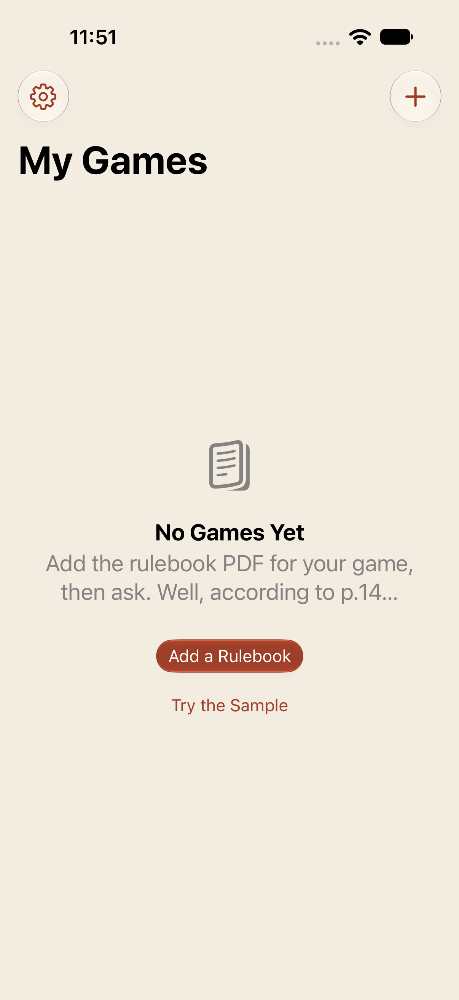 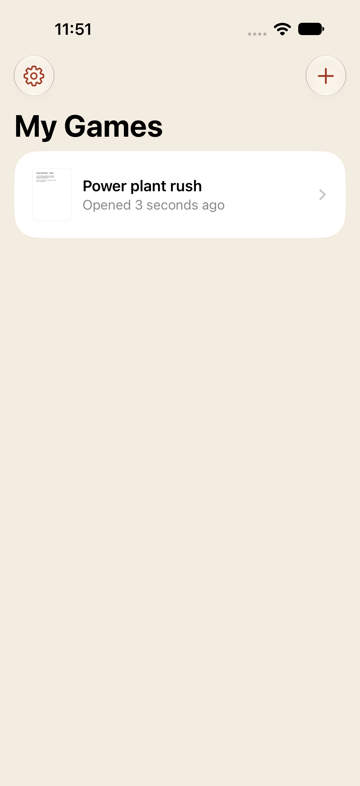 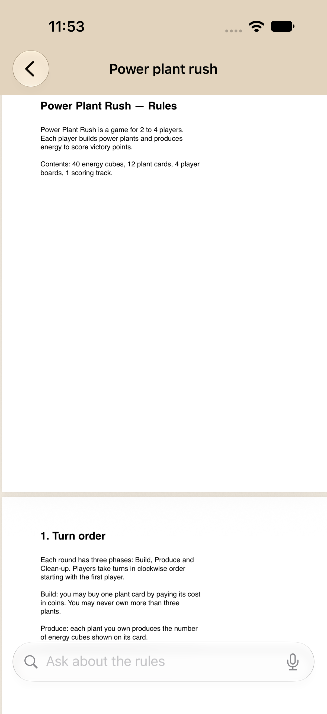 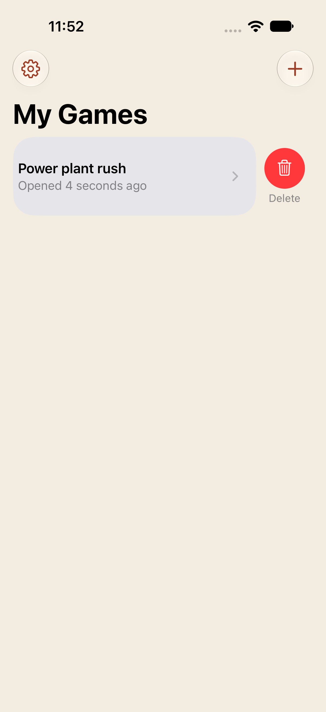 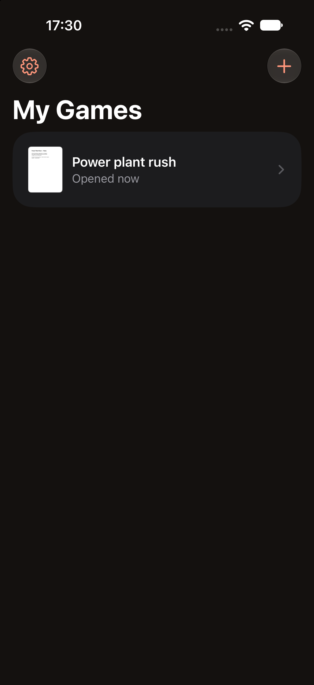 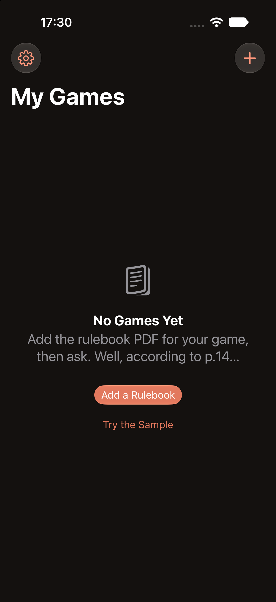 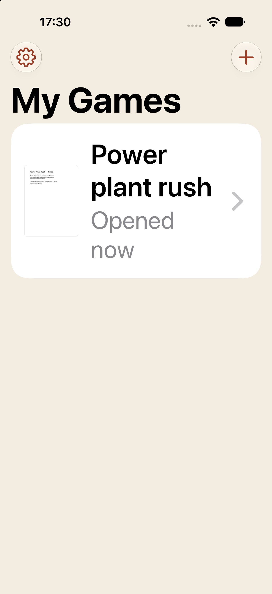
</p>

iPad: list · viewer with the answer inspector and Back
<p>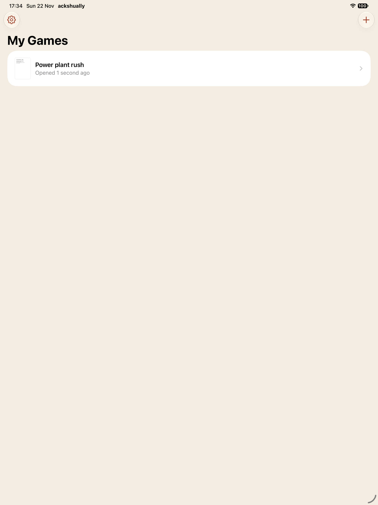 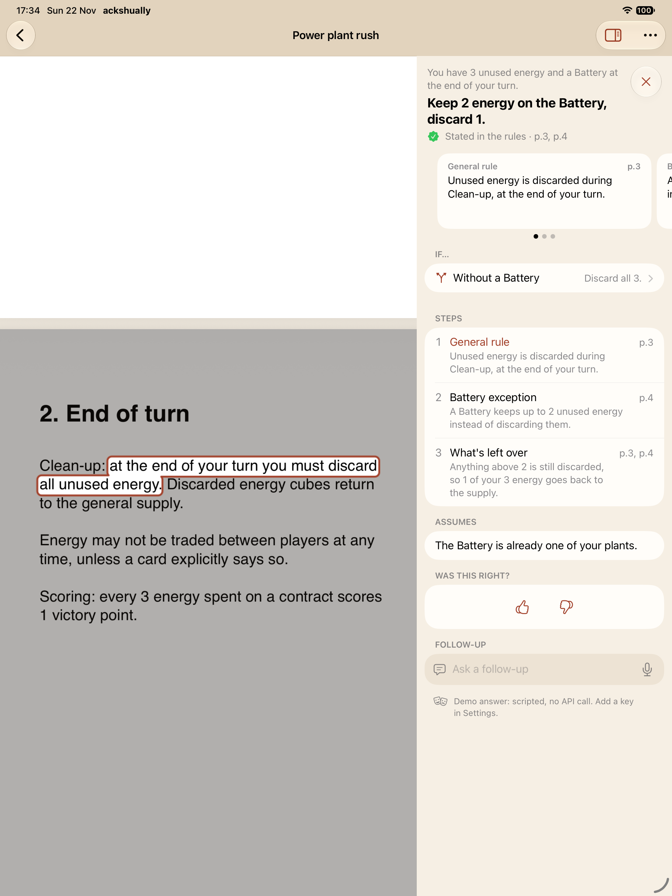</p>

### New components

| Component | Preview states |
|---|---|
| `Library/LibraryScreen` (root stack, importer, Settings sheet, error alert) | games, empty, empty dark, SE, landscape, iPad, AX5, dark |
| `Library/GameList` (rows, swipe delete, cover loading) | games, dark without covers |
| `Library/GameRow`, `Library/GameCover` | cover / placeholder, long name, AX5, dark |
| `Library/EmptyLibraryView` (moved from Viewer) | default, error AX5, dark |
| `Library/LibraryToolbar` | via `LibraryScreen` |
| Model: `LibraryModel` (index, path, covers, add / delete / open), `GameRoute`; Services: `Library` (folder, index file, migration), `CoverCache`; Core: `LibraryIndex`, `LibraryEntry` | `LibraryFixtures` (made-up game names, sample cover) |

### Tests

Core: `LibraryIndexTests` (7: sorting, open moves to top, re-import, remove / prune, ties, file round trip, corrupt file). UI: `LibraryUITests` (6, plus the Settings path in `ServerRouteUITests` updated for the list): empty state (+ Settings from the list), Try the Sample adds and opens it, open a game → ask → back → reopen keeps the answer, swipe to delete (and still gone after relaunch), relaunch opens on the list with the game, `-sample` pushes over the list without joining it. Found while running the suite: `-pdfPath … -ask` without a credential requested Settings before the viewer was pushed, so Settings never opened; `ViewerScreen` now reads `settingsRequested` with `onChange(…, initial: true)` (covered by `testRealRulebookWithoutCredentialOpensSettings`).

### swiftui-pro review

Fixed: the stack's path and the error alert used `Binding(get:set:)` in `body`; now `$library.navigationPath` (a writable model property that opens the game before pushing) and `alert(_:item:)` on `library.error`. Kept: the cover is a `UIImage` rendered by PDFKit (no SwiftUI PDF renderer).

## Answer polish (owner's Azul test)

**Date:** 2026-11-21/22. The owner tried the app on Azul ("If every color available to pick (in factories or center) is one I can't legally place in any pattern line, what do I do on my turn?"). Five problems, all fixed:

| # | Problem (owner's screenshot) | Before | After |
|---|---|---|---|
| 1 | Landscape: bar and answer panel the same beige, one block | `bar` #f3ece1 ≈ `sheet` #f6efe4 | New `navigationBar` token (#e2d3bd / dark #0e0c0a), `chromeSeparator` hairlines under the bar and beside the column; PDF canvas keeps its own `canvas` token |
| 2 | No visible highlight; Azul's red frames looked like ours | 42% yellow PDF annotations | **Nothing was drawn at all** on Azul: its PDF forbids annotations, and PDFKit's character boxes were misplaced (see below). Now a **spotlight** drawn by a page overlay view: the page is dimmed except the cited lines / figure box, outlined in brick. A quote that doesn't match says *Passage not found · showing the whole page* |
| 3 | Verdict: 5 bold lines | "one or two short sentences" | Prompt: one sentence, ≤12 words (bench: median 10, max 12). UI: 3 lines max on the sheet, full text expanded / VoiceOver |
| 4 | Step card text overflowed the card | Text `fixedSize` in a `LazyHStack` card of unmeasured height | All cards share one height = tallest content, text ≤5 lines, **More** opens the expanded answer at that step (plain `HStack`, measured) |
| 5 | Last card repeated the verdict | Closing "Result" card with thumbs + follow-up | No Result card; prompt: last step applies the rule ("Your 3 energy"), never restates; follow-up + thumbs in their own row under the shelf |

Plus, at the owner's request, **⋯ → Answer Details**: every cited passage with page, quote and match status (matched / matched on p.N / matched, not located / not matched (why) / figure box), and **Copy JSON** (raw answer, the model's raw text when it came from Claude, and the match results). Debug builds log the answer JSON and each match with `os.Logger` (subsystem `app.ackshually.viewer`, category `answer`).

### Why the Azul highlights were missing

Reproduced with the real Azul PDF and the owner's question through Core (`bench run` with a one-game question set; raw answers in [evals/results/2026-11-22-azul-highlight-probe](../evals/results/2026-11-22-azul-highlight-probe/report.md)):

1. **The quotes matched**: every Azul quote matched the page text exactly (error 0). The model was right.
2. **The app drew nothing**: Azul's PDF is encrypted with permissions that forbid annotations (`allowsCommenting == false`), so `PDFPage.addAnnotation` silently did nothing. Highlights are now a `PDFPageOverlayViewProvider` view.
3. **The rects were wrong anyway**: PDFKit's `characterBounds(at:)` and `selection(for: NSRange)` bounds are indexed **without the line breaks** in `PDFPage.string` (plus a few characters of drift on some PDFs). On Azul p.3 the box for "On your turn, you must pick tiles…" started 14 characters late and wrapped over 3 lines. This affects all four rulebooks and the generated fixture (macOS and iOS). Core's new `GlyphLocator` picks the index mapping whose box widths correlate with the characters' widths (r ≈ 0.85–0.97 when right, ≈ 0 when wrong), per line of the quote, and returns no rects (→ whole page + note) when nothing fits. Unit tests: `GlyphLocatorTests`, `MatcherTests.testRectsSitOnTheQuote`.
4. The Root miss is different: captions over map art are interleaved with the sidebar in the text layer and lose the decorative "Th" (spec §4 layout-tolerant matching; not done here, the app says so on the PDF).

Owner's question + 3 follow-ups on Azul, 1 question on Root:

**old prompt (2026-11-21, owner question reproduced)**

| Q | Step | Page | Quote | Text match | Geometry (this PR) |
|---|---|---|---|---|---|
| az-owner | 1 | 3 | “On your turn, you must pick tiles in one of the following ways:” | matched | located, r=0.95, 1 rect(s) |
| az-owner | 2 | 4 | “Any tiles you have picked that you cannot or do not want to place a…” | matched | located, r=0.93, 2 rect(s) |
| az-owner | 2 | 4 | “If all spaces of your floor line are occupied, return any further f…” | matched | located, r=0.90, 2 rect(s) |
| az-owner | 3 | 3 | “If you are the first player in this round to pick tiles from the ce…” | matched | located, r=0.92, 2 rect(s) |
| az-owner-f1 | 1 | 3 | “If you are the first player in this round to pick tiles from the ce…” | matched | located, r=0.92, 2 rect(s) |
| az-owner-f1 | 2 | 5 | “If you have the starting player marker in your floor line, it count…” | matched | located, r=0.93, 2 rect(s) |
| az-owner-f1 | 3 | 5 | “The player with the starting player marker refills each of the Fact…” | matched | located, r=0.92, 2 rect(s) |
| az-owner-f1 | 3 | 4 | “filling its spaces from left to right.” | matched | located, r=0.92, 2 rect(s) |
| az-owner-f2 | 1 | 4 | “If all spaces of your floor line are occupied, return any further f…” | matched | located, r=0.91, 2 rect(s) |
| az-owner-f2 | 1 | 3 | “On your turn, you must pick tiles in one of the following ways:” | matched | located, r=0.95, 1 rect(s) |
| az-owner-f2 | 2 | 3 | “also take the starting player marker and place it onto the leftmost…” | matched | located, r=0.93, 2 rect(s) |
| az-owner-f3 | 1 | 5 | “For each tile in your floor line, you lose the number of points ind…” | matched | located, r=0.92, 2 rect(s) |
| az-owner-f3 | 1 | 5 | (figure box) | box ok | box outline |
| az-owner-f3 | 2 | 5 | “however, you can never drop below 0 points” | matched | located, r=0.92, 2 rect(s) |
| az-owner-f3 | 2 | 4 | “If all spaces of your floor line are occupied, return any further f…” | matched | located, r=0.90, 2 rect(s) |
| rt-probe | 1 | 5 | “To move, you must rule the clearing you are moving from or moving to.” | matched | located, r=0.90, 2 rect(s) |
| rt-probe | 2 | 5 | “They do rule this clearing, so they can move here.” | not matched (best error 44%) | — (no text match) |
| rt-probe | 3 | 17 | “but he is Nimble, so he can move regardless of who rules his cleari…” | matched | located, r=0.88, 1 rect(s) |

**new prompt (this PR)**

| Q | Step | Page | Quote | Text match | Geometry (this PR) |
|---|---|---|---|---|---|
| az-owner | 1 | 3 | “On your turn, you must pick tiles in one of the following ways:” | matched | located, r=0.95, 1 rect(s) |
| az-owner | 2 | 4 | “Any tiles you have picked that you cannot or do not want to place a…” | matched | located, r=0.92, 2 rect(s) |
| az-owner | 3 | 4 | “She may even choose to place both tiles in the floor line (C).” | matched | located, r=0.87, 1 rect(s) |
| az-owner-f1 | 1 | 3 | “If you are the first player in this round to pick tiles from the ce…” | matched | located, r=0.92, 2 rect(s) |
| az-owner-f1 | 2 | 5 | “If you have the starting player marker in your floor line, it count…” | matched | located, r=0.93, 2 rect(s) |
| az-owner-f1 | 3 | 5 | “But instead of placing it in the lid, place it in front of you.” | matched | located, r=0.94, 2 rect(s) |
| az-owner-f2 | 1 | 4 | “If all spaces of your floor line are occupied, return any further f…” | matched | located, r=0.91, 2 rect(s) |
| az-owner-f2 | 2 | 3 | “If you are the first player in this round to pick tiles from the ce…” | matched | located, r=0.92, 2 rect(s) |
| az-owner-f2 | 3 | 5 | “But instead of placing it in the lid, place it in front of you.” | matched | located, r=0.94, 2 rect(s) |
| az-owner-f3 | 1 | 5 | “For each tile in your floor line, you lose the number of points ind…” | matched | located, r=0.92, 2 rect(s) |
| az-owner-f3 | 1 | 5 | (figure box) | box ok | box outline |
| az-owner-f3 | 2 | 5 | “however, you can never drop below 0 points” | matched | located, r=0.92, 2 rect(s) |
| az-owner-f3 | 3 | 5 | “Peter loses a total of 8 points as he has 4 tiles and the starting …” | matched | located, r=0.85, 2 rect(s) |
| rt-probe | 1 | 5 | “To move, you must rule the clearing you are moving from or moving to.” | matched | located, r=0.90, 2 rect(s) |
| rt-probe | 2 | 5 | “You rule a clearing if you have the most combined warriors and buil…” | matched | located, r=0.89, 2 rect(s) |
| rt-probe | 3 | 5 | “They don’t rule this clearing either, so they cannot move here.” | not matched (best error 24%) | — (no text match) |


### Screenshots (sample rulebook, demo answers; `m2-screenshots/polish/`)

Spotlight · miss note · equal-height cards · AX L · More → expanded · follow-up row · Answer Details · expanded
<p>
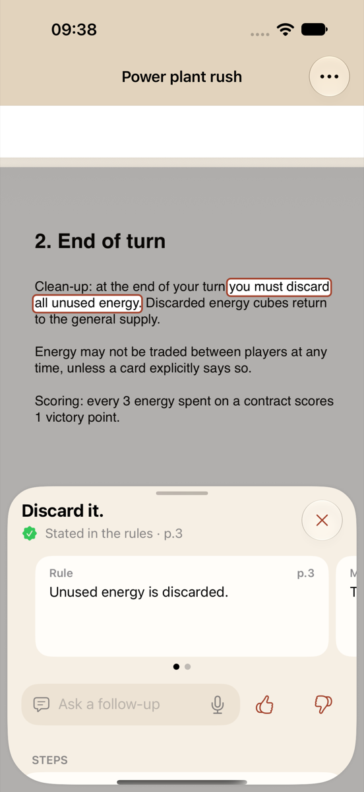 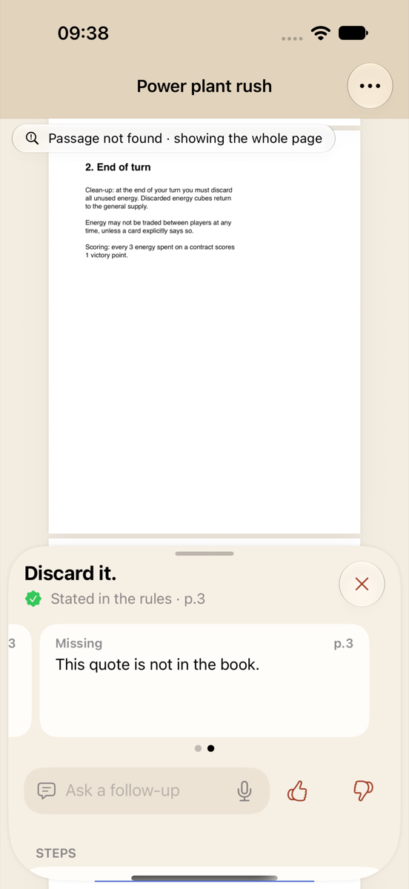 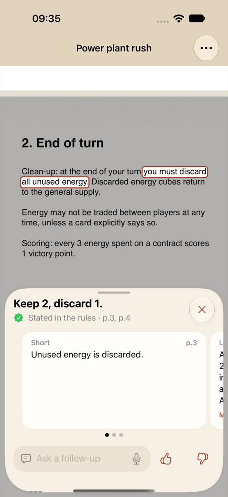 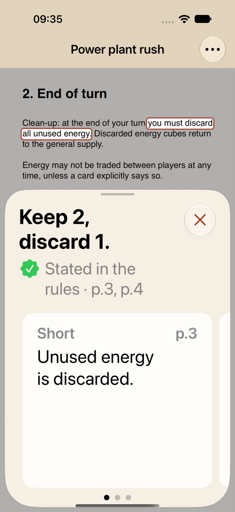 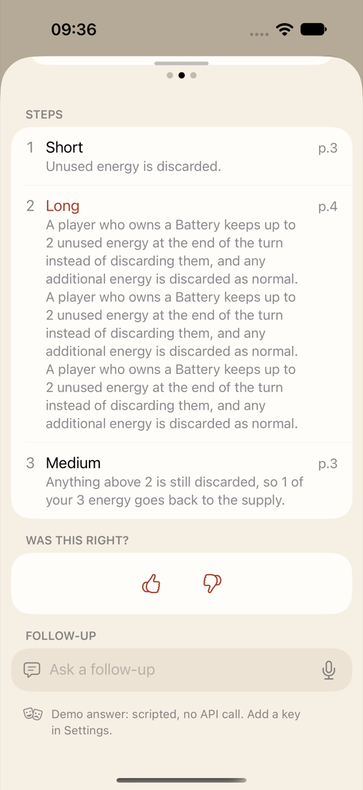 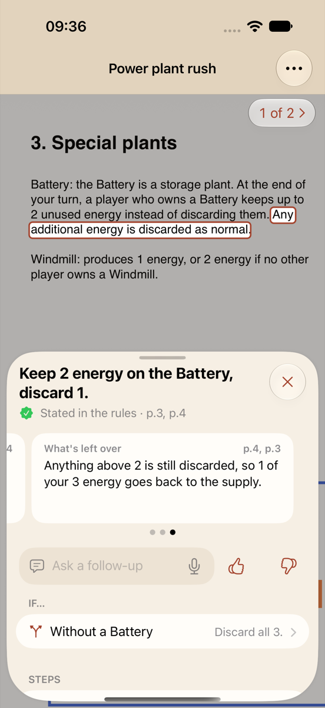 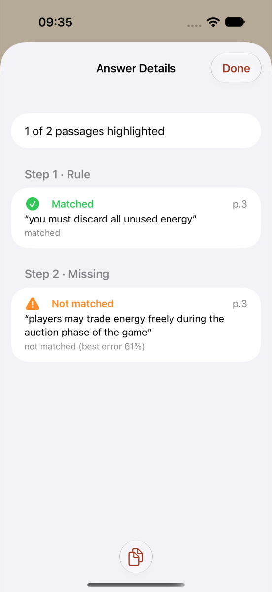 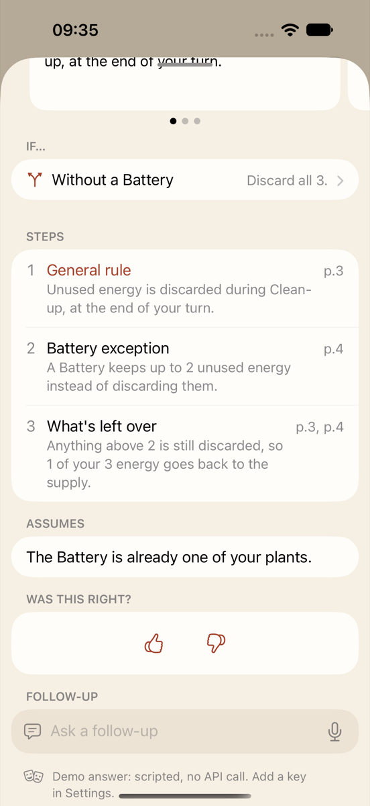
</p>

Landscape: darker bar, hairlines, spotlight
<p>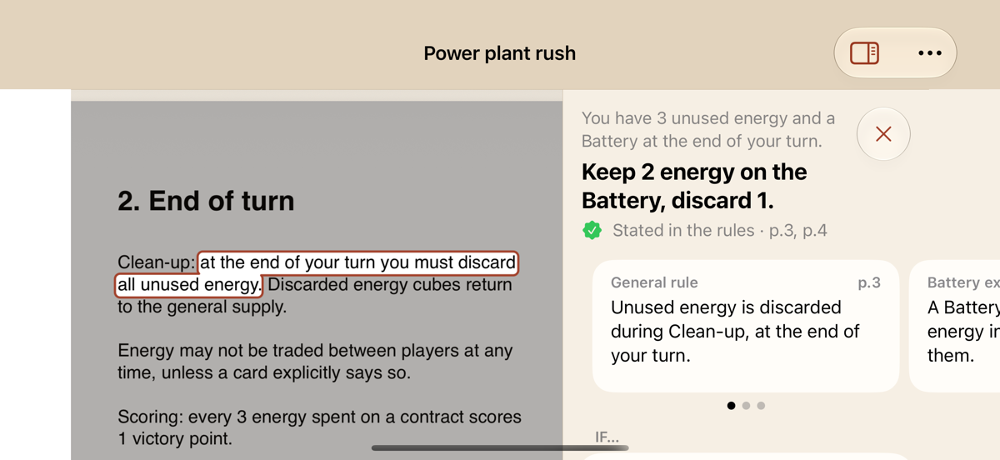</p>

The real-Azul checks (owner's question with the API key, the spotlight on p.3 / p.4) were done by hand and are not committed (copyrighted pages).

### New components

| Component | Preview states |
|---|---|
| `Viewer/SpotlightOverlayView` + `Spotlight` (UIKit overlay inside PDFKit) | via `PDFViewer` previews |
| `AnswerSheet/TruncatingText` (line cap + measured More) | short, long, AX5 |
| `AnswerSheet/AnswerFooterRow` (follow-up + thumbs) | unrated, rated, AX5 dark |
| `AnswerDetails/AnswerDetailsView`, `EvidenceStatusRow` | statuses, dark AX3, AX5 |
| Model: `MatchInfo`, `EvidenceReport`, `AnswerDetailsExport`, `ViewerModel+Details` (reports, JSON, logging) | `Fixtures.evidenceReports` |

### Tests

Core: `GlyphLocatorTests` (3), `MatcherTests.testRectsSitOnTheQuote`, `testPromptLimitsVerdictAndForbidsRepeatingIt`, 38 total. UI (13, iPhone 18 Pro, iOS 27.2): the 8 existing (updated for a shelf without the Result card) plus `testCardTextStaysInsideCard` (default + AX L, equal heights, More → expanded), `testLongVerdictIsCappedUntilExpanded`, `testSpotlightAndExplicitMiss`, `testAnswerDetailsListsMatchStatus`, `testNavigationBarIsDarkerThanAnswerColumn` (pixel luminance in landscape). The PDF view's accessibility value now reads "Zoomed, spotlight N" so tests can see the overlay.

### swiftui-pro review

Fixed: one type per file (`Spotlight`, `AnswerDetailsExport` split out), section grouping moved from `AnswerDetailsView` to `EvidenceReport.sections`. Kept: the PDF overlay is UIKit (PDFKit's overlay provider needs a `UIView`); `StepCard`'s small `body(_:)` text helper.

## Restyle (native iOS)

The owner's verdict on the first build: "it looks like a typical Claude/web chat app, not an iOS app, with lots of pills, text etc." The restyle follows spec §3 ("native iOS, warm") and [design/native-ios.html](design/native-ios.html). Behaviour and the S2–S9 interactions are unchanged.

| | Before (first build) | After |
|---|---|---|
| Answer sheet | Custom overlay (`BottomSheet`): own drag gesture, grabber, shadow, 1 px top border | System `.sheet`: detents measured from the content (collapsed = verdict + proof line, medium = + cards and branch rows, large), `presentationBackgroundInteraction(.enabled(upThrough: medium))` so the PDF stays pinchable/pannable, no swipe-to-dismiss (Close button) |
| Header | "You asked" + restated question, verdict, `FlowRow` of chips: `✓ Stated · p.3, p.4`, branch pills, "Demo answer" flag | Bold verdict (title3) + **one** proof line: `checkmark.seal.fill Stated in the rules · p.3, p.4`. Restated question only while waiting and when expanded. Close / Stop as glass circle buttons |
| While waiting / arriving | Outlined "■ Stop" button, custom pulsing skeleton bars | Glass ask field turns into "Reading the rulebook…" + `stop.circle.fill`; native `.redacted(.placeholder)` for the verdict and the loading card |
| Step cards | Card with 1 px shadow, dimmed when not current, caption "1 · Rule" | Borderless shelf cards (App Store / Music), caption = **step title** + page ("Battery exception · p.4"), page dots like `UIPageControl` |
| Branches | Outlined pills in the header, "‹ Main answer" pill; one branch card with "The rulebook steps are on the main answer" | Inset-grouped rows under the cards ("Without a Battery … Discard all 3. ›"); tapping one swaps the header to the branch verdict and the cards to the **branch's own steps**; a "Main Answer" row returns |
| Expanded | Custom bordered step rows, uppercase labels, plain text | Grouped sections like Settings: Steps (number, title, text, page; current in tint), If…, Assumes, Was this right? (thumbs), Follow-up |
| Feedback | 👍/👎 emoji in outlined boxes | `hand.thumbsup` / `hand.thumbsdown` (filled when chosen), 44 pt targets |
| Ask field | Card-colored rounded field, filled brick mic circle | Liquid Glass bottom field (`magnifyingglass` + text field + `mic`), placed like the iOS 26 bottom search field; inline filled field on the sheet for follow-ups |
| PDF chrome | "⤺ Back to step 2" ink capsule, "1 of 2 ›" ink capsule, outlined note | Glass button "Back to Step 2" (`arrow.uturn.backward`), glass pager "1 of 2 ›", glass note |
| Nav bar | Opaque beige bar, `ellipsis.circle` custom `Menu` | Warm-tinted bar, system `ToolbarOverflowMenu` (⋯); on wide screens a `sidebar.trailing` toggle |
| Wide screens | Custom side panel with a hairline and an xmark | iPad/Mac: standard `.inspector` column. Phone landscape: same content as a trailing column (see below) |
| Empty state | Large title + custom buttons | `ContentUnavailableView` with a glass prominent button |
| Palette | Beige everywhere (`#efe4d0` chrome, `#f4e9d5` sheet, brown ink), provisional dark | Restrained: brick tint, warm bars / sheet / grouped backgrounds, system label colors, white cards; every token has a dark variant |

### Screenshots (sample rulebook, demo answers; `m2-screenshots/restyle/`)

Idle · waiting · arriving · streaming · verdict + step 1 · step 2 · two passages · last card + follow-up
<p>
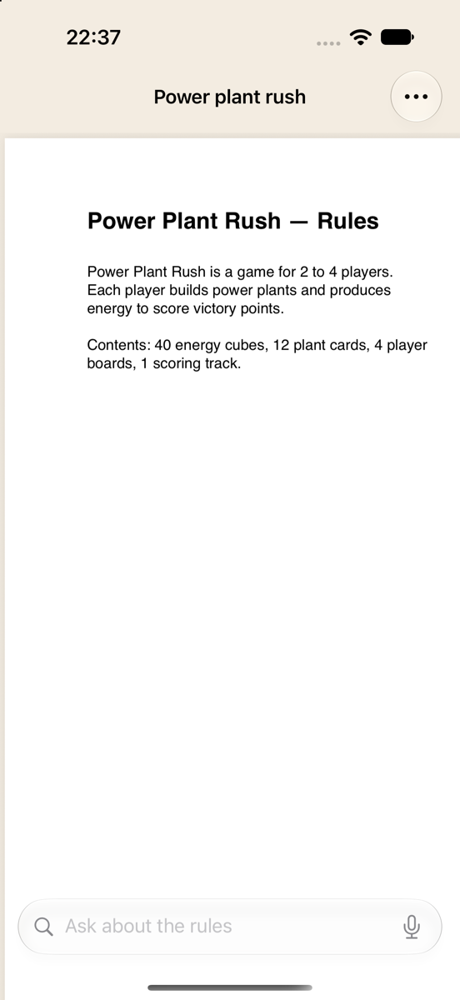 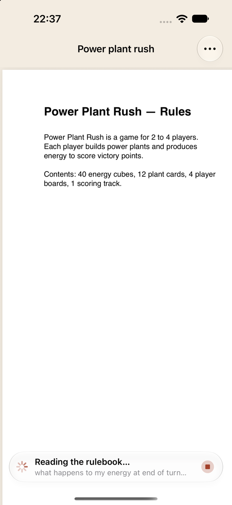 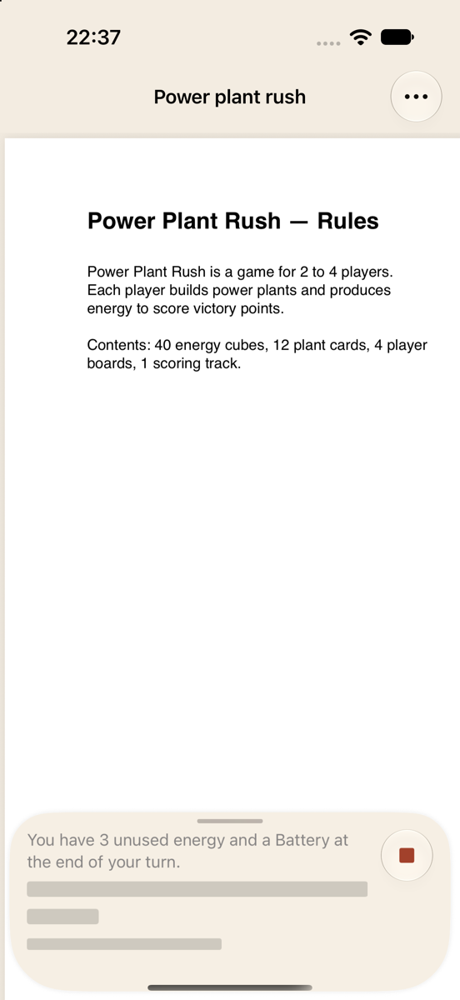 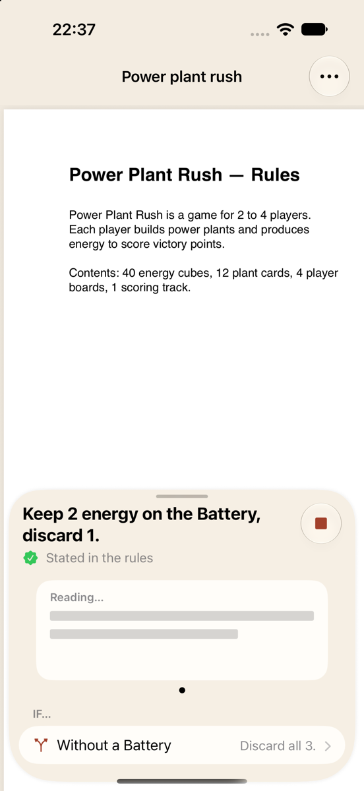 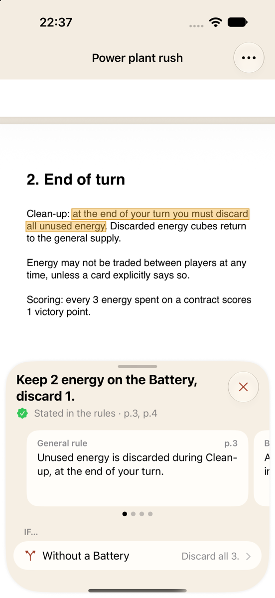 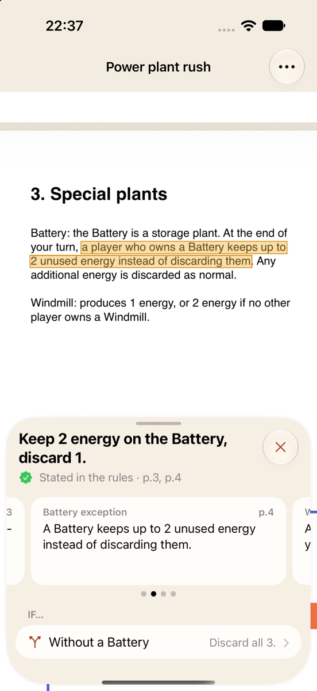 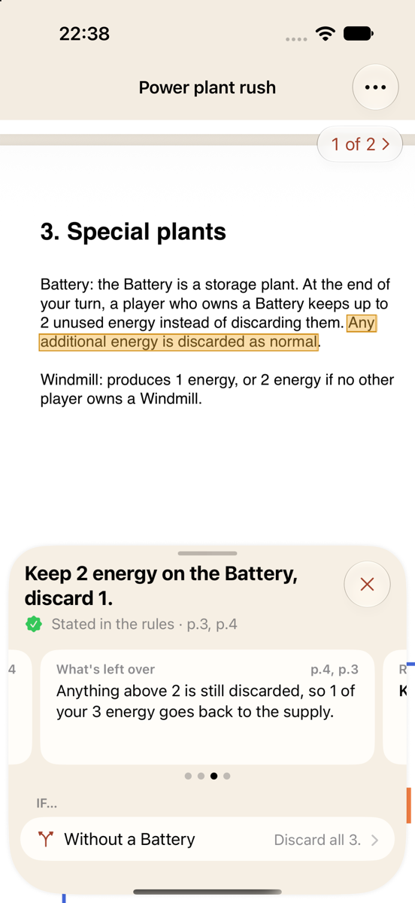 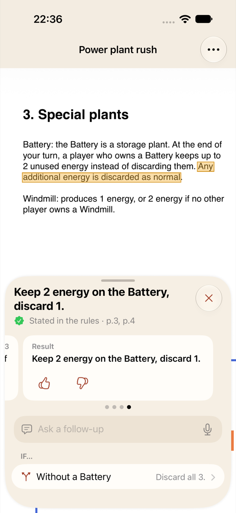
</p>

Collapsed · expanded · branch · Back to Step · double-tap → page
<p>
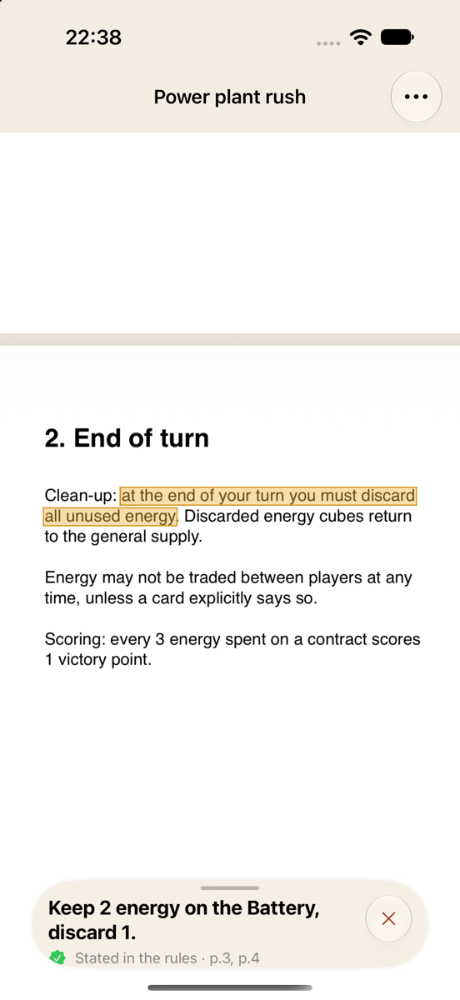 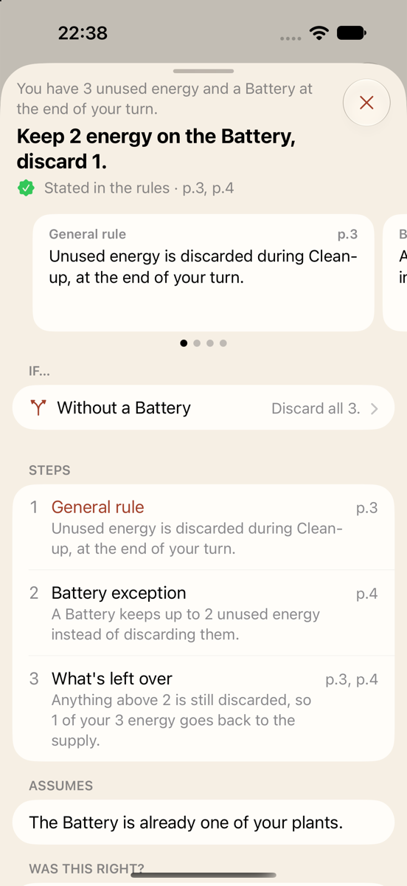 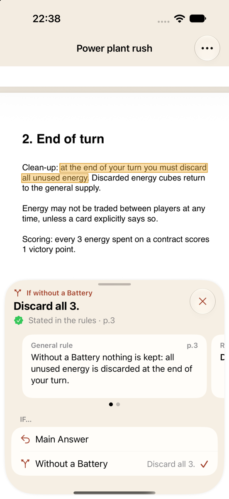 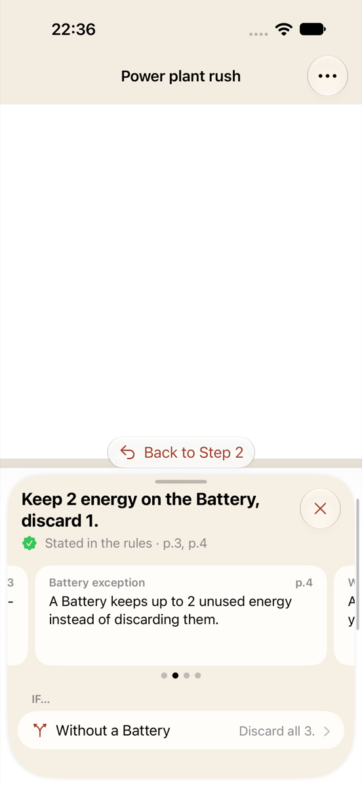 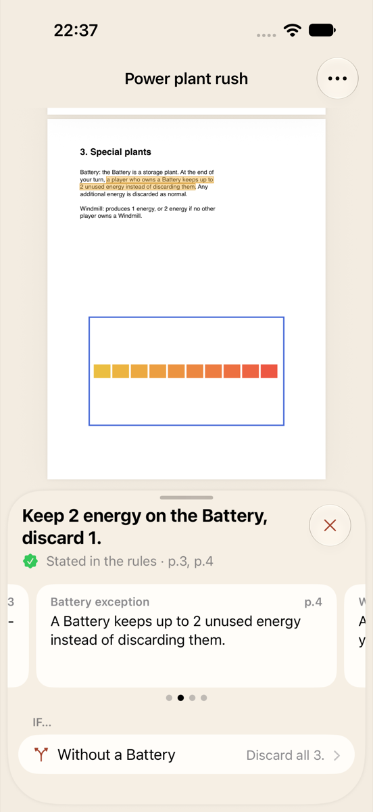
</p>

iPad inspector · phone landscape column
<p>
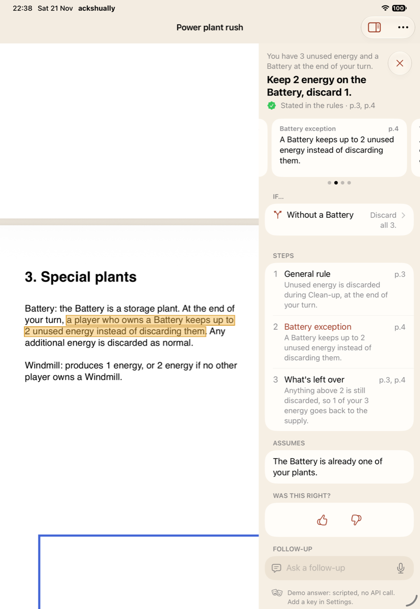 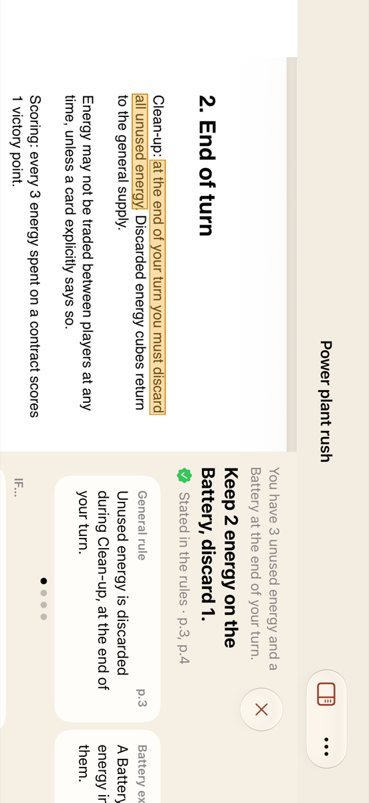
</p>

Dark (medium, expanded, idle) · AX5 Dynamic Type (medium, expanded)
<p>
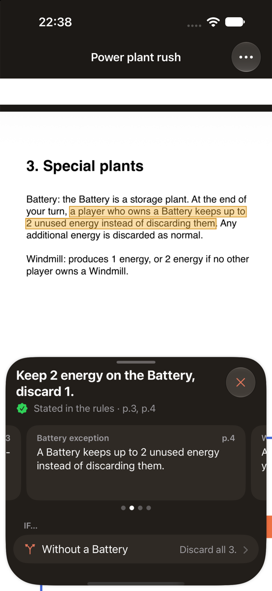 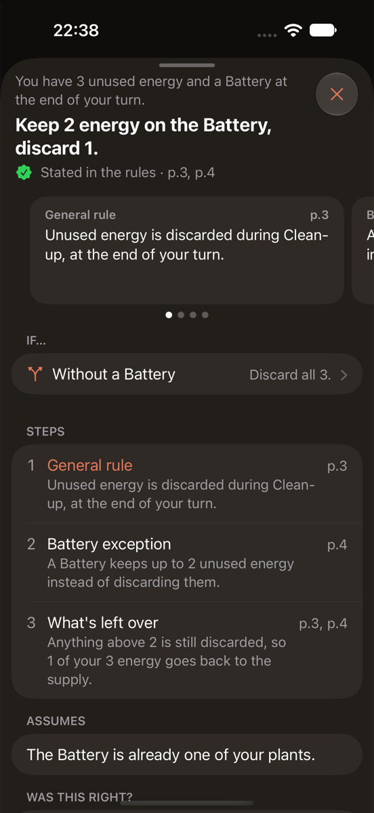 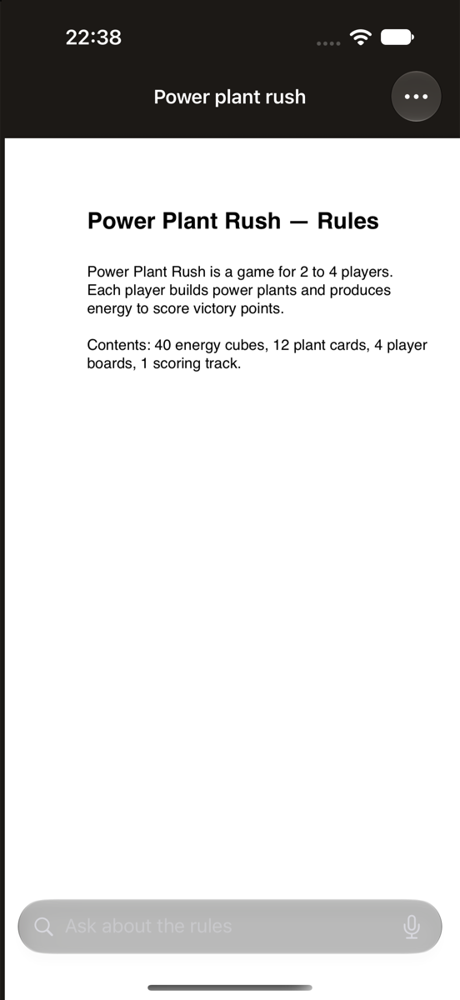 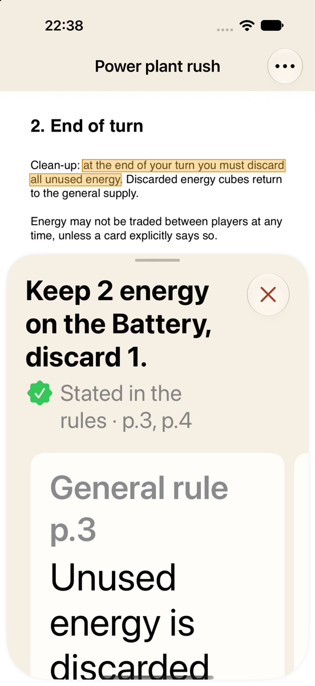 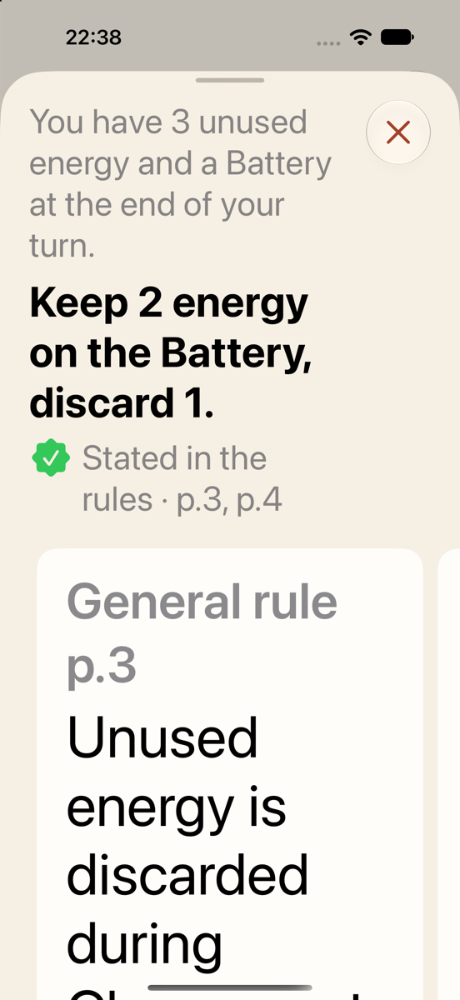
</p>

### What isn't a stock component, and why

1. **The ask field is not `.searchable`.** A search field can't host hold-to-talk (press-and-hold for a live transcript, slide to cancel). It's a `TextField` + mic in a `.glassEffect` capsule placed where the iOS 26+ bottom search field sits.
2. **Phone landscape uses a trailing column, not `.inspector`.** iPhone landscape is compact width, where `.inspector` turns into a sheet (and fought the outgoing answer sheet on rotation, closing the answer). iPad and Mac use the real inspector. Both show the same `AnswerInspector` content.
3. **Grouped rows are `GroupedSection` in a `ScrollView`, not a `List`.** The sheet sizes its collapsed and medium detents from where the header and the branch rows end, which needs one coordinate space; and the shelf's peeking cards must span the sheet's full width, which inset-grouped `List` rows can't. `GroupedSection` mimics inset-grouped styling (rounded group, inset hairline separators, uppercase footnote headers).
4. **Detent heights are measured.** `.height(_)` detents come from the content (capped at 30% / 70% of the window), so the medium detent covers no more of the page than the cards need.
5. **Sheet presentation bindings are read-only.** Nothing can dismiss the sheet or inspector except Close, so the bindings ignore SwiftUI's writes (which only happen when a rotation moves the answer from sheet to column).
6. **The PDF is still PDFKit in a `UIViewRepresentable`** (no SwiftUI PDF view), and the theme's dynamic colors use `UIColor` providers so the same token also works inside PDFKit.

### Contract changes (proposals 1 and 2 below, done)

`Step.title` and `Branch.steps` were added to Core's model, schema, prompt and streaming assembler (both required in the schema, optional when decoding; excerpt-mode page remapping keeps titles and remaps branch evidence). Old answers decode: no title → "Step N", no branch steps → one branch card. **To check in the next bench run:** branch steps stream before the main steps, a few dozen tokens per branch before step 1.

### swiftui-pro review (fixed before the PR)

- Toolbar: the custom ellipsis `Menu` → `ToolbarOverflowMenu` (needs iOS 27, hence the target); the conditional inspector toggle → `.hidden()`.
- One type per file: split `ValueRow`, `StepListRows`, `AssumptionRows`, `CardCaption`, `TrailingIconLabelStyle`, `ViewerMenu`, `ViewerChrome`, `AskFieldBackground`, `SettingsSheet`, `ViewerPresentation`, `AnswerMetrics`, `AnswerPlacement`, `ViewerPreview`, `SlideToCancelHint`, `Confidence+Display`.
- `AnswerContent`'s `some View` helper properties → `AnswerShelf`, `FullAnswerSections`, `FollowUpSection`, `DemoNote`; button actions moved out of `body`.
- 44 pt minimum tap areas for the mic, send, stop, thumbs; close/stop glass buttons at `.large` control size.
- Redundant `.continuous` corner styles removed.
- Kept on purpose: `Binding(get:set:)` for the detent selection (maps the model's detent to measured detents) and the read-only presentation bindings; the peek tap on cards is an `onTapGesture` with an accessibility action (a `Button` would nest the result card's thumbs buttons); the floating field is an overlay rather than `safeAreaBar()` because the PDF must extend under the glass and gets the covered height explicitly.

## What was verified (first build)

| | How | Result |
|---|---|---|
| Build: app (iOS sim, iPad sim), Core (`swift build`) | xcodebuild / swift | ✅ |
| S3 waiting, S4 restated question → verdict → step 1, Stop | UI test + timed simctl screenshots | ✅ |
| S5/S6 carousel: swipe, tap on the peek, PDF follows (page, zoom, highlight), "1 of 2 ›" pager, last card 👍/👎 + follow-up field | UI test | ✅ |
| S7 collapse / S9 expand by dragging, branch pill → branch card → "‹ Main answer" | UI test | ✅ (tapping a step row in S9 is built but not automated) |
| S8 pan → "⤺ Back to step 2" → re-center; tapping the PDF doesn't change the step; double-tap → whole page | UI test | ✅ |
| Follow-up sends the previous turns (Core `history`) | UI test (demo provider) | ✅ the flow works; the context replay is Core code that the evals already exercise |
| Real rulebook: Power Grid PDF + a scripted answer with real quotes | simctl | ✅ quotes matched and highlighted on a two-column page; the page fills the width |
| Real API call | — | ⚠️ **not run**: no `ANTHROPIC_API_KEY` was available in this environment. The app calls `ClaudeProvider` exactly as `bench` does (Sonnet 5.5, json, effort low) |
| Push-to-talk / dictation | — | ⚠️ builds, but not exercised (needs a device mic). Hold ≥0.28 s = live transcript, release sends, slide left past ~18% of the bar's width cancels, tap = dictation |
| iPad side panel, dark (provisional), AX5 Dynamic Type | simctl | ✅ see the screenshots |

## Screenshots of the first build (old look)

S3 waiting · S4 arriving · S5 verdict + step 1 · S6 step 2 · S6 step with two passages · S6 last card
<p>
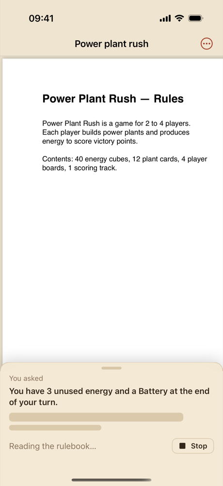 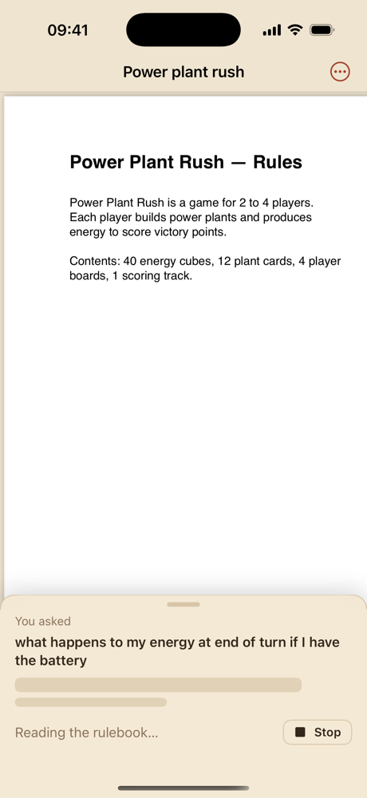    
</p>

S7 collapsed · S8 Back to step · S8 double-tap → page · S9 expanded · S9 branch
<p>
  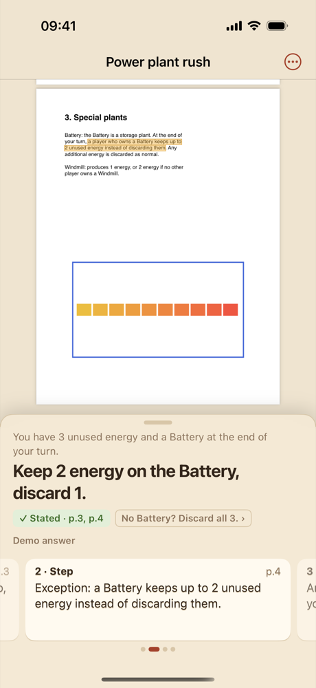  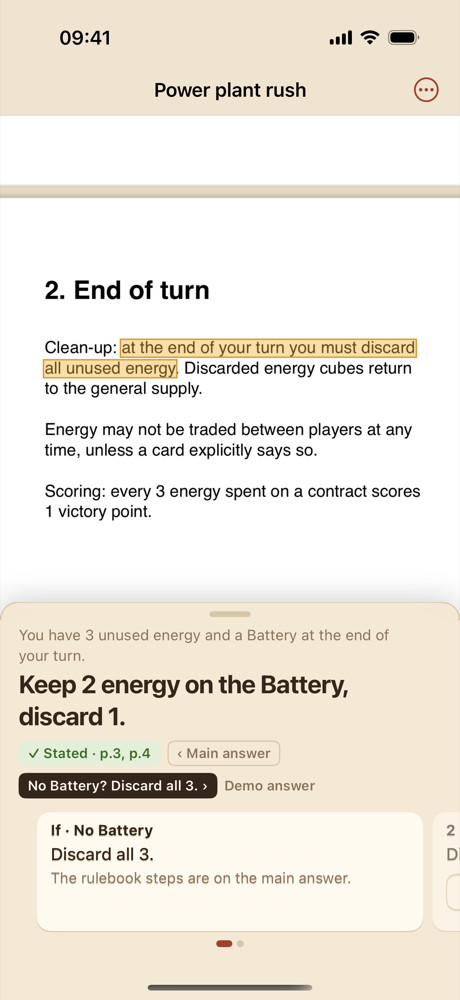
</p>

Wide (iPad side panel) · dark (provisional) · AX5 Dynamic Type
<p>
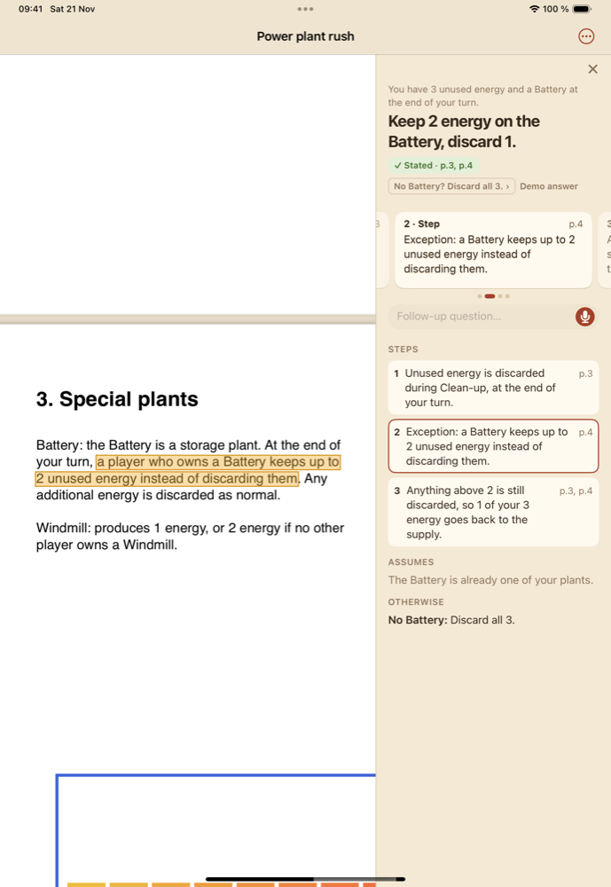 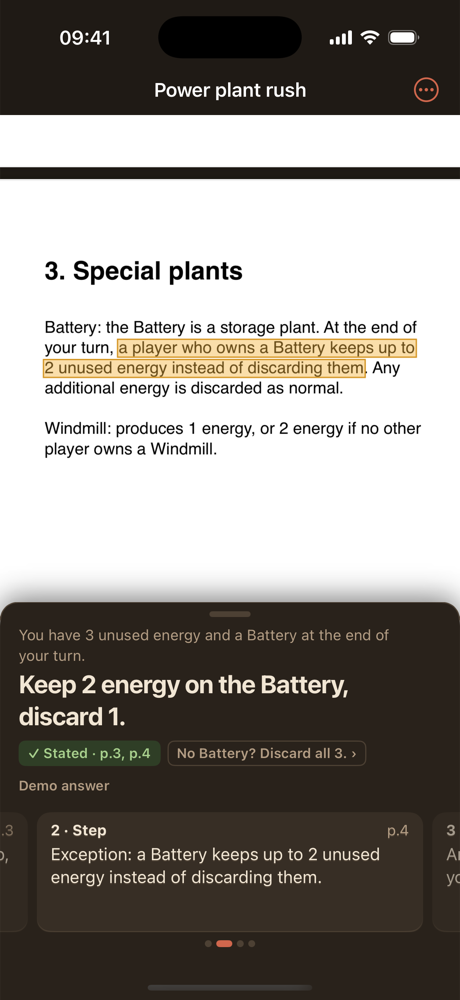 
</p>

The real-rulebook check (Power Grid) is not in these screenshots because the PDFs are copyrighted.

## Calls I made (where the spec was silent or impractical)

1. **Before the first token** (~4–5 s on a real rulebook), the ask bar turns into "Reading the rulebook… ■ Stop". The sheet still rises on the first token, as S4 says, so the table sees progress straight away.
2. ~~**Custom sheet, not `.sheet`.**~~ *Superseded by the restyle: the system sheet now does this.* It keeps the PDF interactive and tells the viewer exactly how much page is covered, so evidence centers in the visible part. Detents: collapsed is content-sized; medium is content-sized up to 62% of the height (it scrolls beyond that, e.g. at AX sizes); expanded is 94%. A flick down from collapsed dismisses the answer and brings back the ask bar. *Decision-log row added.*
3. **Wide screens get a side panel.** On iPad, on Mac, and in phone landscape at ≥640 pt wide, the answer sits in a column beside the PDF (38% of the width, 320–460 pt) with the header, cards, follow-up and step list. `AdaptiveViewerLayout` is the one place that decides this. *Decision-log row added.*
4. **Highlight fallback** (spec §4, M2 subset): quote → word rects from `QuoteMatcher`; otherwise a sane box gets an outline; otherwise the whole page, with a note ("Showing the whole page" / "See the diagram, lower half"). No layout-tolerant matching or repair call, as instructed.
5. **Evidence zoom** fits the passage (with context) in the visible area. It never zooms below page width or above 3.2× page width. On a big, dense page (Power Grid) the passage's lines are as wide as the page, so "zoom to evidence" stays at page width and the print is small. Pinch is the workaround for now (see proposal 4).
6. **Feedback** is in memory only (S11 storage is M3). **Sessions** last until the app quits or another PDF opens (S12 is M3).
7. **The answer header caps Dynamic Type at AX2** so the verdict and cards stay on screen. Everything else scales fully, and spacing and control sizes scale with text through the theme.

## Proposed spec changes

1. ✅ *Done in the restyle.* **Give each step a `title`** in the answer contract (§4 already shows one in its example, but `Core`'s schema and `Step` don't have it). The mockups' "1 · General rule / 2 · Exception" needs it; the app labels cards "1 · Rule", "2 · Step" for now. This is a small schema + `Step` change in Core, best done after the page-selection experiment lands, so that agent's work isn't disturbed.
2. ✅ *Done in the restyle.* **Branches need their own steps** (or at least one evidence item each). S9 says "the step cards switch to that branch", but a branch is only `{condition, verdict}`, so today the branch view is one card plus Result. Proposal: `branches[].steps` (optional, usually 1 step).
3. **Spell out S4 timing:** "between send and the first token the ask bar shows *Reading the rulebook… / Stop*; the sheet rises on the first token" (what's built).
4. **Minimum-legibility zoom:** on large pages, zoom until body text reaches ~15 pt on screen even if the passage's lines overflow horizontally, centered on the passage start. Needs a quick check on the owner's phone first.
5. Add **wide-screen layout** (side panel) to §2 next to S5/S9 (decision rows added in §7).

## Component map (App/Sources)

Leaf views take plain values (`HeaderContent`, `StepCardContent`, `CardItem`, `StepRow`, `BranchRow`, Core models) and closures. State lives in injected `@Observable` models: `ViewerModel` (document, streaming, current card, detent, branch, PDF focus, feedback), `AskController` (push-to-talk over `SpeechInput`) and `ViewerPresentation` (settings / Answer Details, attached to whichever view is frontmost) and `LibraryModel` (My Games: index, navigation path, covers; owns the `ViewerModel`). Design tokens live in `Theme` (dynamic light/dark colors, Dynamic Type-scaled spacing and sizes), injected as `@Environment(\.theme)` by `.themed()`, which also sets the app tint. Previews use `Preview Content/Fixtures.swift`, built on Core's `FixtureRulebook`, so no API key is needed.

| Component | Screen | Preview states |
|---|---|---|
| **DesignSystem/** `Theme`, `ThemeEnvironment` (`.themed()`, `.themeBackground`) | all | — |
| `GroupedSection`, `ValueRow` (inset-grouped rows), `TrailingIconLabelStyle`, `String+LowercasedFirst` | S5, S9 | rows, checkmark, footer, AX5 dark |
| **Features/Ask/** `AskField` (+ `AskFieldBackground`: glass / inline) | S3, follow-up | floating empty/typed, inline, AX5, dark |
| `PushToTalkButton` | S3 | idle, dictating, holding |
| `HoldToTalkPanel`, `SlideToCancelHint`, `Waveform` | S3 | listening, transcript, cancel armed; levels |
| `WaitingBar` (glass) | S3→S4 | default, AX5 dark |
| **Features/AnswerSheet/** `AnswerHeader` (+ `FailureHeader`) | S4, S5, S9 | arriving (redacted), streaming, stated, with question, inferred, not covered, branch, failed, AX5, dark |
| `ProofLine` (+ `Confidence+Display`) | S5, S7 | stated, inferred, not covered, AX5 dark |
| `StepCard`, `CardCaption` | S5, S6, S10 | step, figure, loading, long (More), branch without steps, web, AX5, dark |
| `StepCarousel`, `CardDots` | S5, S6 | iPhone, SE width, AX5, dark |
| `FeedbackButtons` | S6, S9 | none, up, down |
| `BranchRows`, `StepListRows`, `AssumptionRows` | S5, S9 | none active, active, AX5, dark |
| `AnswerShelf`, `FullAnswerSections`, `FollowUpSection`, `DemoNote` (model-bound pieces) | S5–S9 | step 1, AX5 dark |
| `AnswerContent` (+ `AnswerPlacement`, `AnswerMetrics`): the whole answer column | S4–S9, wide | medium, streaming, expanded, branch, inspector AX5, expanded dark |
| `AnswerSheet` (system sheet, measured detents, background interaction) | S5, S7, S9 | via `ViewerPreview` |
| `AnswerInspector` (inspector column / landscape column) | wide | iPad landscape |
| **Features/Viewer/** `PDFViewer` (PDFKit, highlights, zoom, gestures) | S5, S6, S8 | evidence zoom, whole page |
| `HighlightOverlay` (glass pager, notes), `BackToStepPill` (glass) | S6, S8 | 2 passages, figure note, whole page, AX3/AX5, dark |
| `AdaptiveViewerLayout` (sheet vs inspector vs landscape column; covered height for the PDF) | S3–S9 | iPhone 18 Pro, SE, Pro Max, landscape, iPad, AX5, dark, streaming, branch, collapsed, expanded, idle |
| `ViewerScreen` (pushed from My Games), `ViewerMenu` (`ToolbarOverflowMenu`, answer items only), `ViewerChrome`, `ViewerDialogs`, `ViewerPreview` | S2 | answered, idle, removed dark |
| **Features/Library/** `LibraryScreen` (root `NavigationStack`), `GameList`, `GameRow`, `GameCover`, `LibraryToolbar`, `EmptyLibraryView` (`ContentUnavailableView`) | S1 | games, empty, error AX5, SE, landscape, iPad, AX5, dark |
| **Features/Settings/** `SettingsView`, `SettingsSheet` | dev | default, dark AX5 |
| **Model/** `ViewerModel` (+`Content`), `AnswerState`, `ViewContent`, `ViewerPresentation`, `HighlightPlacer`, `AskController`, `LibraryModel`, `GameRoute` | — | — |
| **Services/** `DemoProvider` (now with step titles and a branch step), `Keychain`/`APIKeyStore`, `Library` (folder, `library.json`, migration), `CoverCache`, `SpeechInput` | — | — |

## Known gaps / next

- Run a real question on the owner's iPhone with a key (time to first token, verdict and step 1, against the M1 numbers).
- Push-to-talk on a device: check the hold threshold and the slide-to-cancel distance at the table.
- Restyle: check the sheet's detent heights and the glass field on the owner's iPhone (simulator only so far), and the step-1 latency with the v2 contract on a real rulebook.
- `scrollPosition(id:)` ignores its initial value, so the carousel scrolls to it on appear (`ScrollViewReader`). It works, but watch for it on iOS 18 changes.
- Evidence on a page that `QuoteMatcher` scrambles (Root multi-column) falls back to the whole page until the layout-tolerant matcher lands in Core.
