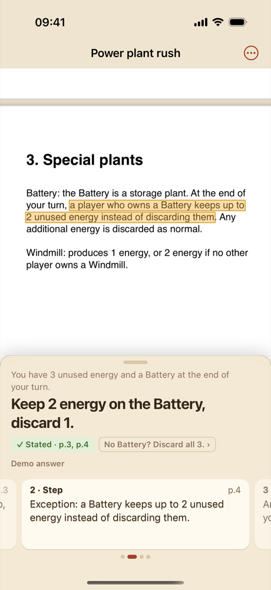
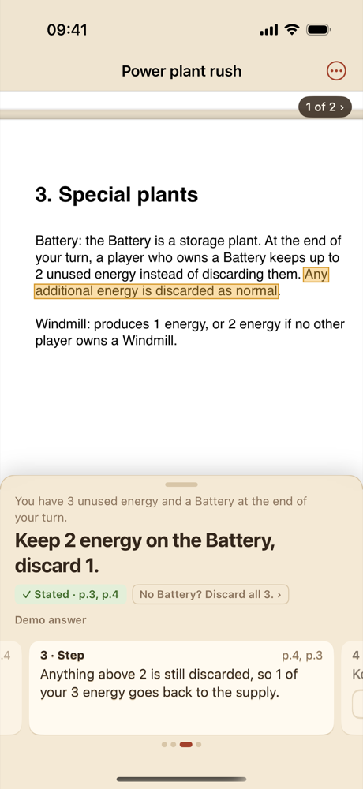
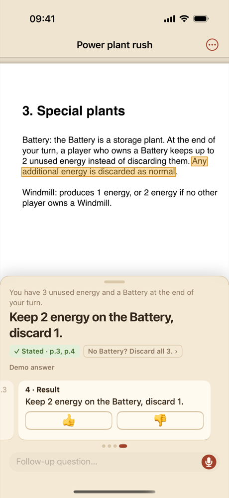
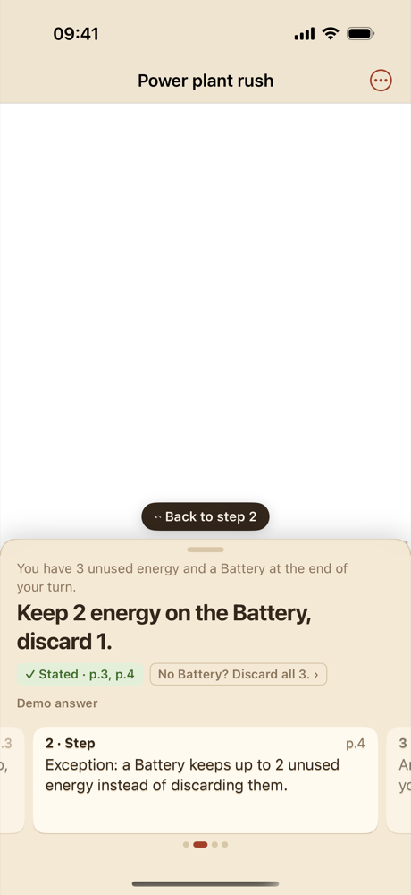
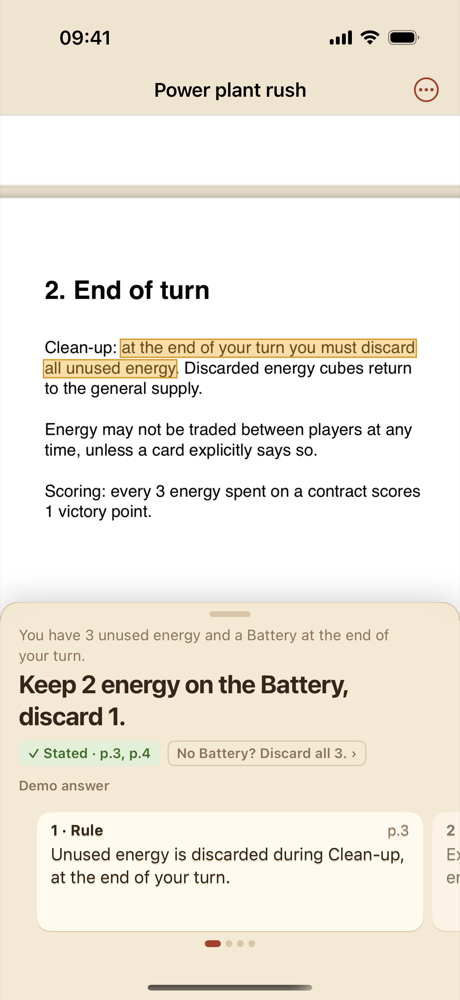
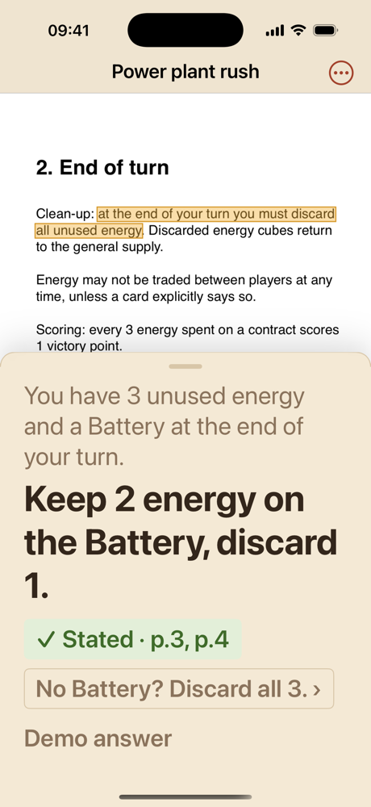

# M2 notes: iOS viewer

**Date:** 2026-11-21 · **Scope:** S3–S9 plus a minimal S2 (open a PDF, reopen it on relaunch). Built on `Core/` (unchanged).

## Run it

```sh
cd App && xcodegen            # optional: regenerate from project.yml (XcodeGen 2.42+); the .xcodeproj is checked in
open App/Ackshually.xcodeproj  # scheme "Ackshually", iOS 17+, iPhone first; runs on iPad and on Mac ("Designed for iPad")
```

- **API key.** Use ⋯ → Settings → paste the key; it's stored in the Keychain. On the simulator you can also pass it at launch: `SIMCTL_CHILD_ANTHROPIC_API_KEY=sk-ant-… xcrun simctl launch booted app.ackshually.viewer`. Without a key, the app streams a scripted **demo answer** and labels it "Demo answer".
- **Rulebook.** ⋯ → Open a rulebook PDF… (file importer; the PDF is copied into Application Support and reopened on the next launch), or ⋯ → Sample rulebook (Core's fake "Power Plant Rush").
- **Device.** Pick your team under Signing & Capabilities, then run on the iPhone. Push-to-talk needs a real device; the simulator has no live mic input in automation.
- **Launch arguments** (simulator and screenshots): `-sample YES`, `-pdfPath /abs/file.pdf`, `-demo YES`, `-demoAnswer /abs/answer.json` (a spec §4 JSON), `-ask "…"`, `-present YES`, `-card N`, `-branch N`, `-detent collapsed|medium|expanded`. Details are in `App/Sources/App/LaunchOptions.swift`.
- **UI tests:** `xcodebuild test -project App/Ackshually.xcodeproj -scheme Ackshually -destination 'platform=iOS Simulator,name=iPhone 16 Pro'`. Four tests run on the sample with demo answers: streaming → stepping (swipe and peek tap), inspect → Back to step → tap PDF → double-tap, branch pill + detents, and a follow-up. Add `TEST_RUNNER_SCREENSHOT_DIR=/some/dir` to save screenshots.

## What was verified

| | How | Result |
|---|---|---|
| Build: app (iOS sim, iPad sim), Core (`swift build`) | xcodebuild / swift | ✅ |
| S3 waiting, S4 restated question → verdict → step 1, Stop | UI test + timed simctl screenshots | ✅ |
| S5/S6 carousel: swipe, tap on the peek, PDF follows (page, zoom, highlight), "1 of 2 ›" pager, last card 👍/👎 + follow-up field | UI test | ✅ |
| S7 collapse / S9 expand by dragging, branch pill → branch card → "‹ Main answer" | UI test | ✅ (tapping a step row in S9 is built but not automated) |
| S8 pan → "⤺ Back to step 2" → re-center; tapping the PDF doesn't change the step; double-tap → whole page | UI test | ✅ |
| Follow-up sends the previous turns (Core `history`) | UI test (demo provider) | ✅ the flow works; the context replay is Core code that the evals already exercise |
| Real rulebook: Power Grid PDF + a scripted answer with real quotes | simctl | ✅ quotes matched and highlighted on a two-column page; the page fills the width |
| Real API call | — | ⚠️ **not run**: no `ANTHROPIC_API_KEY` was available in this environment. The app calls `ClaudeProvider` exactly as `bench` does (Sonnet 5.5, json, effort low) |
| Push-to-talk / dictation | — | ⚠️ builds, but not exercised (needs a device mic). Hold ≥0.28 s = live transcript, release sends, slide left past ~18% of the bar's width cancels, tap = dictation |
| iPad side panel, dark (provisional), AX5 Dynamic Type | simctl | ✅ see the screenshots |

## Screenshots (sample rulebook, demo answers)

S3 waiting · S4 arriving · S5 verdict + step 1 · S6 step 2 · S6 step with two passages · S6 last card
<p>
     
</p>

S7 collapsed · S8 Back to step · S8 double-tap → page · S9 expanded · S9 branch
<p>
    
</p>

Wide (iPad side panel) · dark (provisional) · AX5 Dynamic Type
<p>
  
</p>

The real-rulebook check (Power Grid) is not in these screenshots because the PDFs are copyrighted.

## Calls I made (where the spec was silent or impractical)

1. **Before the first token** (~4–5 s on a real rulebook), the ask bar turns into "Reading the rulebook… ■ Stop". The sheet still rises on the first token, as S4 says, so the table sees progress straight away.
2. **Custom sheet, not `.sheet`.** It keeps the PDF interactive and tells the viewer exactly how much page is covered, so evidence centers in the visible part. Detents: collapsed is content-sized; medium is content-sized up to 62% of the height (it scrolls beyond that, e.g. at AX sizes); expanded is 94%. A flick down from collapsed dismisses the answer and brings back the ask bar. *Decision-log row added.*
3. **Wide screens get a side panel.** On iPad, on Mac, and in phone landscape at ≥640 pt wide, the answer sits in a column beside the PDF (38% of the width, 320–460 pt) with the header, cards, follow-up and step list. `AdaptiveViewerLayout` is the one place that decides this. *Decision-log row added.*
4. **Highlight fallback** (spec §4, M2 subset): quote → word rects from `QuoteMatcher`; otherwise a sane box gets an outline; otherwise the whole page, with a note ("Showing the whole page" / "See the diagram, lower half"). No layout-tolerant matching or repair call, as instructed.
5. **Evidence zoom** fits the passage (with context) in the visible area. It never zooms below page width or above 3.2× page width. On a big, dense page (Power Grid) the passage's lines are as wide as the page, so "zoom to evidence" stays at page width and the print is small. Pinch is the workaround for now (see proposal 4).
6. **Feedback** is in memory only (S11 storage is M3). **Sessions** last until the app quits or another PDF opens (S12 is M3).
7. **The answer header caps Dynamic Type at AX2** so the verdict and cards stay on screen. Everything else scales fully, and spacing and control sizes scale with text through the theme.

## Proposed spec changes

1. **Give each step a `title`** in the answer contract (§4 already shows one in its example, but `Core`'s schema and `Step` don't have it). The mockups' "1 · General rule / 2 · Exception" needs it; the app labels cards "1 · Rule", "2 · Step" for now. This is a small schema + `Step` change in Core, best done after the page-selection experiment lands, so that agent's work isn't disturbed.
2. **Branches need their own steps** (or at least one evidence item each). S9 says "the step cards switch to that branch", but a branch is only `{condition, verdict}`, so today the branch view is one card plus Result. Proposal: `branches[].steps` (optional, usually 1 step).
3. **Spell out S4 timing:** "between send and the first token the ask bar shows *Reading the rulebook… / Stop*; the sheet rises on the first token" (what's built).
4. **Minimum-legibility zoom:** on large pages, zoom until body text reaches ~15 pt on screen even if the passage's lines overflow horizontally, centered on the passage start. Needs a quick check on the owner's phone first.
5. Add **wide-screen layout** (side panel) to §2 next to S5/S9 (decision rows added in §7).

## Component map (App/Sources)

Leaf views take plain values (`HeaderContent`, `StepCardContent`, `CardItem`, `StepRow`, Core models) and closures. State lives in two injected `@Observable` models: `ViewerModel` (document, streaming, current card, detent, branch, PDF focus, feedback) and `AskController` (push-to-talk state over `SpeechInput`). Design tokens live in `Theme`, injected as `@Environment(\.theme)` by `.themed()`, which picks the light/dark palette and scales spacing and sizes with Dynamic Type. Previews use `Preview Content/Fixtures.swift`, built on Core's `FixtureRulebook`, so no API key is needed.

| Component | Screen | Preview states |
|---|---|---|
| **DesignSystem/** `Theme`, `ThemeEnvironment` (`.themed()`, `.themeBackground`) | all | — |
| `SkeletonLine`, `FlowRow`, `OutlinePill`, `OutlineButton` / `PrimaryButton` | S4, S5 | default |
| **Features/Ask/** `AskBar` | S3, follow-up | empty, typed, compact, AX5 |
| `PushToTalkButton` | S3 | idle, dictating, holding, compact |
| `HoldToTalkPanel` + `SlideToCancelHint`, `Waveform` | S3 | listening, transcript, cancel armed; levels |
| `WaitingBar` | S3→S4 | default |
| **Features/AnswerSheet/** `AnswerHeader` (+ `FailureHeader`) | S4, S5 | arriving/skeleton, streaming, stated, inferred, not covered, branch active, failed, AX5, dark |
| `ConfidenceChip` | S5, S7 | stated, inferred, not covered, short, AX5 |
| `BranchPills` | S5, S9 | none active, active |
| `StepCard` (+ `CardTitle`) | S5, S6, S10 | step, figure, loading, result, result rated, branch, web ⚠, not current, AX5, dark |
| `FeedbackButtons` | S6 | none, 👍, 👎 |
| `StepCarousel`, `CardDots` | S5, S6 | iPhone, SE width, AX5 |
| `CollapsedVerdictBar` | S7 | stated, not covered, AX5 |
| `FullAnswerList` (+ `SectionLabel`) | S9 | default, AX5 |
| `BottomSheet` (detents, drag) | S5, S7, S9 | medium, collapsed, expanded, medium AX5 |
| `AnswerSections` (`BoundAnswerHeader`, `BoundStepCards`, `AnswerMedium/Collapsed/ExpandedContent`, `AnswerSidePanel`): model-bound composites | S4–S9, wide | medium, streaming, expanded, side panel |
| **Features/Viewer/** `PDFViewer` (PDFKit, highlights, zoom, gestures) | S5, S6, S8 | evidence zoom, whole page |
| `HighlightOverlay` (pager, notes) | S6 | 2 passages, figure note, whole page |
| `BackToStepPill` | S8 | default, AX3 |
| `AdaptiveViewerLayout` (sheet vs side panel, the only layout decision) | S3–S9 | iPhone 16 Pro, SE, Pro Max, landscape, iPad, AX5, dark, streaming, idle |
| `ViewerScreen` (nav, importer, settings), `EmptyLibraryView` | S2 | answered, empty, error AX5 |
| **Features/Settings/** `SettingsView` | dev | default |
| **Model/** `ViewerModel` (+`Content`), `AnswerState`, `ViewContent`, `HighlightPlacer`, `AskController` | — | — |
| **Services/** `DemoProvider`, `Keychain`/`APIKeyStore`, `Library`, `SpeechInput` | — | — |

## Known gaps / next

- Run a real question on the owner's iPhone with a key (time to first token, verdict and step 1, against the M1 numbers).
- Push-to-talk on a device: check the hold threshold and the slide-to-cancel distance at the table.
- `scrollPosition(id:)` ignores its initial value, so the carousel scrolls to it on appear (`ScrollViewReader`). It works, but watch for it on iOS 18 changes.
- Evidence on a page that `QuoteMatcher` scrambles (Root multi-column) falls back to the whole page until the layout-tolerant matcher lands in Core.
